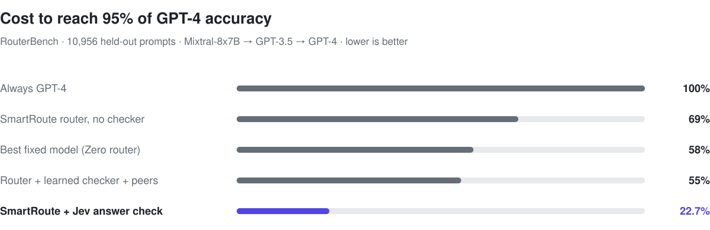
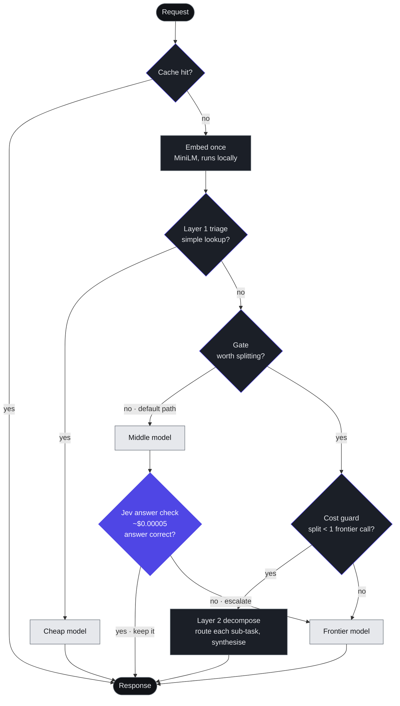

<picture>
  <source media="(prefers-color-scheme: dark)" srcset="assets/header-dark.svg" />
  
</picture>

<p align="center">
  <b>An LLM router that sends each request to the cheapest model that can answer it,<br>
  checks the answer, and pays for the frontier model only when the check fails.</b>
</p>

<p align="center">
  
  
  
  
  
</p>

## Results in brief

- **95% of GPT-4's accuracy at 23–28% of GPT-4's cost** on RouterBench (36,483 prompts, 11 models).
- **Beats RouterBench's own baseline** (the best fixed model at each price) on both model ladders tested. The 95% confidence intervals exclude zero.
- **Spots wrong answers with 0.93 AUC** for about $0.00005 per check. The next-best checker scored 0.81 and needed two extra model calls per prompt.
- **Doesn't oversell itself:** the same harness showed that on everyday assistant questions, routing cost 4× more than always using the cheap model, with no gain in accuracy.

## Benchmarks

<picture>
  <source media="(prefers-color-scheme: dark)" srcset="assets/benchmark-dark.svg" />
  
</picture>

The test replays [RouterBench](https://huggingface.co/datasets/withmartian/routerbench), a public dataset of 36k prompts (MMLU, GSM8K, HellaSwag, MBPP, …). It stores each model's recorded answer, grade and cost, so no models are called. Results come from 5 random 70/30 splits; every number is measured on the held-out 30% (about 10,956 prompts).

| Approach | Kind | Cost to reach 95% of GPT-4 accuracy ↓<br><sub>ladder A / ladder B</sub> | AIQ ↑<br><sub>ladder A / ladder B</sub> |
|---|---|---|---|
| Always GPT-4 | baseline | 100% / 100% | — |
| Best fixed model (RouterBench Zero router) | competitor | 58% / 58% | 0.750 / 0.757 |
| SmartRoute router, no answer check | ablation | 75% / 69% | 0.720 / 0.741 |
| Router + learned checker + peer agreement | competitor | 59% / 55% | 0.736 / 0.752 |
| **SmartRoute + Jev answer check** | **this project** | **27.5% / 22.7%** | **0.772 / 0.788** |
| Perfect checker | theoretical ceiling | 26% / 23% | 0.794 / 0.808 |

<sub>Ladder A: Mistral-7B → Mixtral-8x7B → GPT-4. Ladder B: Mixtral-8x7B → GPT-3.5 → GPT-4. **AIQ** is RouterBench's headline metric: average accuracy across the whole cost range (higher is better).</sub>

At a single setting on ladder B, SmartRoute scores **80.0% accuracy at $0.0032 per query**. Always using GPT-4 scores 79.6% at $0.0080, so SmartRoute matches GPT-4 for 40% of the cost.

**What made the difference:** routing logic alone gets you only as far as "always use the middle model". The gain comes from noticing when the middle model's answer is wrong. With a perfect checker, the router would match GPT-4 at about 1/8 of its cost, and Jev gets close to that:

| Answer checker | How it decides | Extra cost per prompt | AUC |
|---|---|---|---|
| **Jev** | a decision model is asked "is this answer correct?" | ~$0.00005 | **0.93** |
| Learned + peer agreement | an embedding classifier, averaged with peer agreement | ~2 model calls | 0.81 |
| Peer agreement | do two similarly priced models agree? | ~2 model calls | 0.75–0.77 |
| Learned | classifier on MiniLM embeddings of prompt + answer | $0 | 0.70 |

**Caveats:** RouterBench's models date from 2023, and its benchmarks are public, so some may be in Jev's training data. Calibrate the escalation threshold on your own graded traffic before relying on these numbers. Full method, confidence intervals and reproduction commands are in [BENCHMARK.md](BENCHMARK.md#routerbench-results).

## Architecture



Each request goes through three cheap decisions and one optional check:

1. **Triage.** A logistic-regression head over a frozen MiniLM embedding asks whether this is a simple lookup. If it is, the cheap model answers. The semantic cache reuses the same embedding, so each prompt is embedded only once.
2. **Gate.** A second head estimates whether the request should be split into parts. If not, the request goes to the middle model, which is the default. Nothing goes to the frontier model by default.
3. **Decompose.** The middle model splits the request into sub-tasks and routes each one separately. A hard dollar check cancels the split if it would cost more than a single frontier call.
4. **Check.** Jev scores the middle model's answer. The request escalates to the frontier model only when Jev doubts the answer.

**The thresholds come from a cost formula, not from tuning.** Sending a request to the cheap model saves `middle − cheap` when the cheap model is right. It costs `λ` (the operator's price for a wrong answer) when it is wrong. So the classifier needs a precision of at least `λ / (saving + λ)` to break even. The trainer saves a measured precision/recall curve. The router picks the lowest threshold that meets that precision, and turns layer 1 off if no threshold does.

### Components

| Module | Responsibility |
|---|---|
| `catalog.py` | Loads models, prices and tiers from `models.yaml`. Refuses unpriced models, tier ladders that don't rise in price, and judges grading their own model family |
| `decision.py` | Layer 1 triage, the gate, and the expected-cost rule |
| `decomposer.py` | Layer 2: split the request, route the sub-tasks, synthesise, bail out on cost |
| `escalation.py` | Answer checkers: Jev, learned, self-consistency, ensembles |
| `taskroute.py` | Alternative dispatch: picks a model per prompt from task type, effort, and OpenRouter's live benchmark rankings |
| `server.py` | OpenAI-compatible FastAPI endpoint. Routing metadata goes in the `X-SmartRoute-Meta` header |
| `cache.py` · `db.py` · `observability.py` | pgvector semantic cache, Postgres decision log, Prometheus metrics and OpenTelemetry traces |
| `harness/` | Offline routing evaluation, live cost and accuracy runs, RouterBench replay with confidence intervals |

**Stack:** Python 3.13 · LiteLLM · sentence-transformers · scikit-learn · FastAPI · Postgres/pgvector · Prometheus · OpenTelemetry · Docker

## Quickstart

```bash
git clone https://github.com/kartikeyaagr/SmartRoute && cd SmartRoute
```

```bash
uv sync --extra server --extra ml --group dev && cp .env.example .env   # then add one provider key
```

```bash
uv run pytest   # 246 tests, no network needed
```

Use it as a library:

```python
from smartroute import Router

answer, decision = Router().route([{"role": "user", "content": "What's the capital of Australia?"}])
decision.route_path          # "cheap"
decision.gate_reason         # "lookup p=0.76 >= 0.5"
decision.estimated_cost_usd
```

Or run it as a drop-in OpenAI-compatible server and change one `base_url`. The Jev check needs `TYPESAFE_API_KEY` or `OPENROUTER_API_KEY`:

```bash
JEV_ESCALATION=true uv run smartroute-server   # POST /v1/chat/completions on :8000
```

Providers are a config change. The repo ships Together AI (`models.yaml`), Anthropic and Groq catalogs, and a test checks that swapping catalogs works end to end.

## Where routing doesn't pay

On 200 questions written to look like everyday assistant traffic, the Claude ladder (Haiku 4.5 → Sonnet 5 → Opus 5) answered **100% correctly at every tier**. Always using the cheap model cost $0.0012 per query. Routing cost $0.0049 per query, about 4× as much, with no gain in accuracy. Routing only pays when some of your traffic actually fails on the cheap model. The harness tells you which case you are in before you ship:

```bash
uv run --extra ml python -m harness.eval_routing --compare          # routing accuracy, offline, free
uv run --extra ml python -m harness.run_routing --n 200 --arm all   # live cost and accuracy, all arms
```

Known limits are documented in [BENCHMARK.md](BENCHMARK.md):
- The decompose head has a precision of 0.18 because it was trained on only 30 positive examples.
- Layer 2 has never paid for itself on a 5× price ladder.
- Jev has not yet been validated on live traffic.

## License

[GNU GPL v3](LICENSE).
